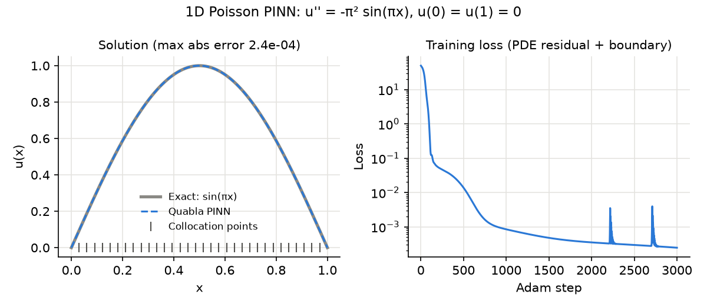

# Quabla

Release 1.1.0 is a bug-fix release that preserves the public API. It repairs
numerical boundaries, input validation, serialization, control flow, solvers
and linear algebra, and completes the Python protocols of tensors. See the
[release notes](CHANGELOG.md#110---2026-11-09).

CPU, MLX and CUDA/NCCL acceptance is recorded in the
[roadmap](docs/jax_like_roadmap.md#v110-plan-bug-fixes-and-robustness-2026-11-08);
the [1.1.0 audit](docs/benchmarks/v110-audit-20261108-04/README.md) records
its evidence and performance limitations.

Differentiable scientific computing in Python, powered by Rust. Quabla
provides higher-order automatic differentiation for physics-informed neural
networks (PINNs), with CPU, CUDA, and Apple silicon backends.

[](https://github.com/latteine1217/quabla/actions/workflows/ci.yml)
[](https://pypi.org/project/quabla/)
[](#license)

[User guide](https://latteine1217.github.io/quabla/guide/)
· [API reference](https://latteine1217.github.io/quabla/api.html)
· [Release notes](CHANGELOG.md)

## Why Quabla

A PINN loss can depend on derivatives of a model with respect to its inputs.
Training then requires differentiating that loss with respect to the model
parameters. Quabla lets you express these nested derivatives as Python
function transforms:

- Compose `grad`, `jvp`, `vjp`, `jacobian`, `hessian`, and `vmap` to build
  derivatives and evaluate them over batches.
- Use `jit` to trace a function into an execution plan and select a backend.
  The CPU interprets that plan; CUDA and MLX execute device operations.
- Train with Adam, AdamW, SGD, or L-BFGS. For GPU training,
  `optim.Trainer` keeps parameters and optimizer state on the device.

The API will look familiar to JAX users, but Quabla does not depend on JAX
and is not a drop-in replacement. Check the [limitations](#known-limitations)
before porting a program.

## Installation

Use Python 3.10–3.14. Choose one distribution for your environment:

| Platform and backend | Install |
| --- | --- |
| Linux x86_64 or aarch64, CPU or CUDA | `python -m pip install quabla` |
| macOS arm64, CPU | `python -m pip install quabla` |
| macOS 14+ on Apple silicon, CPU or MLX | `python -m pip install quabla-mlx` |

Both distributions provide the `quabla` import. Install only one per
virtual environment; uninstall it before switching to the other.
On platforms without a wheel, installation builds from source and requires
Rust 1.88 or newer; that build enables only the CPU backend.

Linux wheels do not bundle CUDA libraries. CPU execution needs no CUDA
installation; GPU execution additionally needs an NVIDIA driver and
`libnvrtc`. Some operations need cuBLAS or cuSOLVER, and data parallelism
needs NCCL. See the [runtime requirements](docs/guide/10-devices.md#103-cuda-runtime-requirements).

Verify the installation:

```sh
python -c "import quabla as qb; print(qb.__version__); print(qb.devices())"
```

`devices()` lists backends compiled into the package, not detected hardware.
A listed CUDA backend does not confirm that a GPU or its libraries are
available.

## Quickstart

This example runs on the CPU and needs only Quabla:

```python
import quabla as qb


def loss(x):
    return qb.sum(x ** 2)


x = qb.array([1.0, 2.0, 3.0])
step = qb.jit(qb.value_and_grad(loss))
value, gradient = step(x)
print(value.item())
print(gradient.tolist())
```

```text
14.0
[2.0, 4.0, 6.0]
```

`value_and_grad` returns the function value and its gradient with respect
to the first argument. `jit` traces and compiles on the first call, then
reuses the plan for matching shapes, dtypes, and parameter structure.

To compute a second derivative at several points, compose `grad` with `vmap`:

```python
def u(x):
    return qb.sin(x)


u_xx = qb.vmap(qb.grad(qb.grad(u)))
print(u_xx(qb.array([0.0, 0.5, 1.0])).tolist())
```

The result is `-sin(x)` at each point, up to floating-point rounding.
The [getting started guide](docs/guide/01-getting-started.md) explains
tracing, arrays, and transforms. For named input specifications and explicit
IR inspection, see the [compiler facade](docs/guide/10-devices.md#107-the-compiler-facade).

## Backend Support

Select a backend per compiled function. Using the `loss` above:

```python
x = qb.array([1.0, 2.0, 3.0], dtype=qb.float32)
step = qb.jit(qb.value_and_grad(loss), device="cuda:0")  # or "mlx", "cpu"
value, gradient = step(x)
```

| Backend | Platform | Floating-point types | Main constraints |
| --- | --- | --- | --- |
| CPU | macOS, Linux | `float32`, `float64` | Interprets execution plans; `float32` operations use the `float64` reference rounded to `float32` |
| CUDA | Linux, NVIDIA GPU | `float32`, `float64` | Requires CUDA runtime libraries; each program uses one floating-point dtype |
| MLX | macOS 14+, Apple silicon | `float32` | Rejects `float64`; some matrix factorizations run on MLX's CPU stream |
| CUDA + NCCL | Linux, 2+ GPUs on one node | `float32` | Experimental data parallelism; equal batch shards and host optimizer updates |

Arrays default to `float64`; create `float32` arrays for MLX. Mixing
`float32` and `float64` arrays requires an explicit `astype`. Unsupported
operations raise an error rather than silently selecting another backend.

See [Devices and Compilation](docs/guide/10-devices.md) for control-flow
support, library requirements, precision, and backend-specific limitations.

## PINN Example

The [PINN tutorial](docs/guide/11-pinn-tutorial.md) builds a neural network
for a 1D Poisson problem. It explains the differential equation, boundary
conditions, nested derivatives, training loop, and comparison with an
analytical solution.

From a source checkout with Quabla installed, run:

```sh
python examples/pinn_poisson.py                 # one-parameter model, CPU
python examples/pinn_mlp.py --device cpu        # neural network, CPU
```

For GPU runs, select `--device mlx` or `--device cuda` with the corresponding
build and runtime libraries. See [examples](examples/README.md) for setup,
benchmarks, and multi-GPU validation commands.



*A 16-unit tanh MLP trained as a PINN on the CPU backend (3,000 Adam steps)
matches the exact solution `sin(πx)` to a max abs error of 2.4e-4.
Reproduce with `python examples/plot_readme_figure.py`.*

## Known Limitations

- Shapes are static. Changing input shapes, dtypes, or parameter structure
  requires a new trace. Shapes must fit addressable F64 CPU workspace;
  invalid or unaddressable sizes are rejected during construction or tracing.
- Dtypes are limited to `float32`, `float64`, and `bool`; there is no integer
  array dtype. Indexing uses static Python integers, not dynamic index
  tensors or boolean masks.
- The CPU has no machine-code JIT. CUDA loops with non-elementwise bodies
  run from the host; MLX has no fused Metal loop kernels or `vmap` HVP
  lowering.
- `while_loop` has no reverse-mode derivative. Jacobians and Hessians are
  dense arrays, and third or higher Cholesky derivatives use scalar
  expansion, which is slow beyond small matrices.
- Data parallelism is limited to CUDA + NCCL on a single node.

See the [API limitations](docs/api.md#known-limitations) for the full
contract. The [compatibility policy](CONTRIBUTING.md#scope-and-status)
defines the public Python API guarantees for 1.x; internal Rust APIs and
backends are outside that policy. Use the [migration guide](docs/guide/15-migration.md)
when updating code written for 0.x.

## Installation From Source

Prerequisites:

- Rust 1.88 or newer (`rustup`), the minimum supported Rust version (MSRV)
  declared in `Cargo.toml`.
- Python 3.10 or newer and maturin 1.x (1.9.3 or later).
- MLX builds: macOS on Apple silicon, CMake, and Xcode's Metal Toolchain
  (`xcodebuild -downloadComponent MetalToolchain`). The Python `mlx` wheel is
  not used. The build writes the compiled Metal library to
  `~/.mlx/lib/<key>/mlx.metallib`, or to `$MLX_RS_METAL_PATH` when that
  variable is set at build time. At run time MLX first looks for an
  `mlx.metallib` next to the extension module and then at that build path,
  so keep it in place (or rebuild after removing it).
- CUDA builds: Linux with an NVIDIA driver. CUDA libraries are loaded at run
  time: `libnvrtc.so` is required, `libcublas` is used for rank-two `f32`
  GEMM when present (otherwise an NVRTC tiled kernel), and `libcusolver` is
  required for `solve`. Put their directory on `LD_LIBRARY_PATH`. The loaded
  `libnvrtc` must not be newer than the CUDA version the driver supports;
  otherwise loading generated kernels fails with
  `CUDA_ERROR_UNSUPPORTED_PTX_VERSION`. The two-GPU validation used CUDA 12.6.
- CUDA + NCCL builds: additionally NCCL loadable as `libnccl.so` (for example
  through `LD_LIBRARY_PATH`) and at least two CUDA devices. Ordinary `cuda`
  builds neither link nor load NCCL.

Create a virtual environment and build the extension in place:

```sh
git clone https://github.com/latteine1217/quabla.git
cd quabla
python3 -m venv .venv
source .venv/bin/activate
python -m pip install "maturin>=1.9.3,<2"

# Pick one:
maturin develop --release                        # CPU only
maturin develop --release --features mlx         # macOS, Apple silicon
maturin develop --release --features cuda        # Linux, CUDA
maturin develop --release --features cuda-nccl   # Linux, CUDA + NCCL

python -c "import quabla; print(quabla.__version__, quabla.Compiler().capabilities())"
```

### Building Wheels

`maturin build --release` writes a wheel for the active interpreter to
`target/wheels/` (`--out DIR` changes the directory); pass the same
`--features` as for `maturin develop`. A wheel contains the `quabla`
package, the compiled extension, its type stub `_quabla.pyi`, and `py.typed`.
For an MLX wheel that works on other machines, ship the Metal library next
to the extension, where MLX looks first:

```sh
export MLX_RS_METAL_PATH="$PWD/target/mlx-metal"
cargo build --release -p quabla-core --features mlx   # writes mlx.metallib
cp "$MLX_RS_METAL_PATH/mlx.metallib" python/quabla/
MACOSX_DEPLOYMENT_TARGET=14.0 maturin build --release --features mlx
```

The `Wheels` workflow ([.github/workflows/wheels.yml](.github/workflows/wheels.yml))
builds the published distributions for CPython 3.10 to 3.14: `quabla` wheels
for Linux x86_64 and aarch64 (manylinux_2_28, `cuda-nccl` features) and macOS
arm64 (CPU), the `quabla` source distribution, and `quabla-mlx` wheels for
macOS arm64 (`mlx` feature). Version tags publish them to TestPyPI and then PyPI through
trusted publishing, each upload after approval; a manual run builds them and
can publish to TestPyPI only.

## Documentation

| Task | Document |
| --- | --- |
| Install and write your first program | [Getting Started](docs/guide/01-getting-started.md) |
| Learn the Python API | [User guide](docs/guide/README.md) |
| Train a PINN | [PINN tutorial](docs/guide/11-pinn-tutorial.md) |
| Look up signatures and behavior | [API reference](docs/api.md) |
| Diagnose tracing or device errors | [Performance and debugging](docs/guide/12-performance-debugging.md) |
| Run examples and benchmarks | [Examples](examples/README.md) |
| Propose a change or run development checks | [Contributing](CONTRIBUTING.md) |
| Review feature status and validation records | [Roadmap](docs/jax_like_roadmap.md) |

Implementation history is documented in the [core design notes](docs/design.md)
and [v0.2 API design](docs/api_v0_2_design.md). Quabla was formerly named
Nabla; it is not affiliated with JAX or the `nabla-ml` project.
For vulnerability reports, see [SECURITY.md](SECURITY.md). Citation metadata
is in [CITATION.cff](CITATION.cff).

## License

Quabla is licensed under either of [Apache License, Version 2.0](LICENSE-APACHE)
or [MIT license](LICENSE-MIT), at your option.
